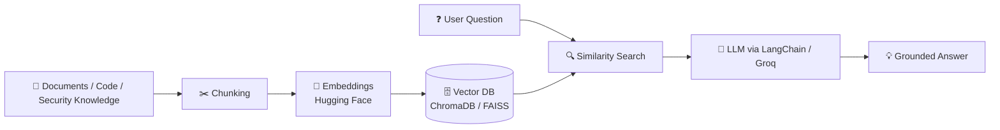
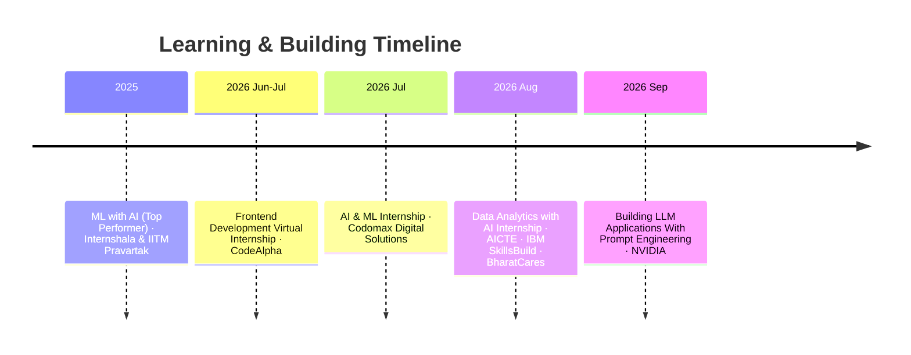

<div align="center">


# ✨ Shravani Kale ✨


<p>
  <a href="https://portfolio-snowy-six-vvmg7lik8u.vercel.app/"></a>
  <a href="https://www.linkedin.com/in/kale-shravani/"></a>
  <a href="mailto:shravanikale18@gmail.com"></a>
  <a href="https://leetcode.com/u/shravanikale38/"></a>
  <a href="https://github.com/ShravaniKale18"></a>
</p>

<p>
  
  
  
  
</p>

</div>

---

## 🖥️ `whoami`

```bash
shravani@sggsiet:~$ whoami
> Shravani Kale, B.Tech IT (3rd year) @ SGGSIET Nanded

shravani@sggsiet:~$ cat status.txt
> 🟢 Open to internships: SDE · Python · AI/ML · GenAI · Data Analyst

shravani@sggsiet:~$ cat motto.txt
> Learn. Build. Improve. Repeat.
```

```python
class Shravani:
    def __init__(self):
        self.role      = "B.Tech IT Student & Builder"
        self.college   = "SGGSIET, Nanded"
        self.cgpa      = 8.98
        self.languages = ["Python", "Java", "C++", "JavaScript"]
        self.loves     = ["RAG", "LLM apps", "AI agents", "ML", "Flask APIs"]
        self.dsa       = "300+ problems on LeetCode & Code360"
        self.hunting   = ["SDE", "Python Dev", "AI/ML", "Data Analyst"]

    def next_move(self):
        return "Ship something cool, then ship the next one 🚀"
```

---

## 🔭 Currently Exploring

| | Focus | What I'm doing |
| :-: | :--- | :--- |
| 🤖 | **Generative AI & LLMs** | Intelligent web apps and workflow tools |
| 🔎 | **RAG architectures** | Context retrieval with vector databases |
| 🧠 | **Multi-agent systems** | Autonomous AI agent workflows |
| 🐍 | **Backend engineering** | APIs with Python, Flask and Node.js |
| 🔐 | **Cybersecurity** | AI-driven vulnerability analysis and security tooling |
| 💻 | **DSA** | Sharpening problem solving every week |

---

## 🛠️ Tech Arsenal

<div align="center">


<p>
  
  
  
  
  
  
  
  
  
  
</p>

</div>

---

## 🧬 How My RAG Projects Work

Several of my projects (PDF Notes Assistant, GitHub Repository Assistant, PhishGuard) share this core idea:



---

## 🚀 Featured Projects

<div align="center">

<a href="https://github.com/ShravaniKale18/PDF-Notes-Assistant"></a>
<a href="https://github.com/ShravaniKale18/GitHub-Repository-Assistant"></a>
<a href="https://github.com/ShravaniKale18/Student_Performance_Prediction"></a>
<a href="https://github.com/ShravaniKale18/insurance-charges-prediction"></a>
<a href="https://github.com/ShravaniKale18/Smart-Expense-Manager-System"></a>
<a href="https://github.com/ShravaniKale18/weather-web-app"></a>

</div>

<details open>
<summary><b>🛡️ PhishGuard · AI Phishing Message & URL Analyzer</b></summary>
<br/>

Analyzes suspicious messages and URLs, gives a **0–100 risk score**, spots urgency and credential-harvesting tactics, and explains them using RAG-powered security knowledge.

`Python` `Streamlit` `LangChain` `FAISS` `Sentence Transformers`

[🚀 Live Demo](https://phishgaurd---ai-phishing-message-analyzer-b5aw8qqdualgw83rnvkk.streamlit.app/)
</details>

<details>
<summary><b>📚 PDF Notes Assistant · Chat with your PDFs</b></summary>
<br/>

Upload a PDF, ask questions, and get answers from the right passages. Parsing, chunking, embeddings, ChromaDB retrieval and Groq-accelerated reasoning.

`Python` `Flask` `LangChain` `ChromaDB` `Hugging Face` `Groq` `PyPDF`

[📂 Repository](https://github.com/ShravaniKale18/PDF-Notes-Assistant)
</details>

<details>
<summary><b>🤖 GitHub Repository Assistant · Talk to any codebase</b></summary>
<br/>

Ingests a GitHub repo and answers natural-language questions with semantic search and context-aware code explanations.

`Python` `LangChain` `Hugging Face` `ChromaDB` `Streamlit` `RAG`

[📂 Repository](https://github.com/ShravaniKale18/GitHub-Repository-Assistant)
</details>

<details>
<summary><b>🧑‍🤝‍🧑 Multi-Agent Research System · A team of AI agents</b></summary>
<br/>

Specialized agents collaborate on retrieval, analysis and synthesis, producing structured research summaries.

`Python` `Streamlit` `AI Agents` `LLMs`

[🚀 Live Demo](https://multi-agent-research-system-ejzkqjr7uwexjtrbxchmme.streamlit.app/)
</details>

<details>
<summary><b>🎓 Student Performance Prediction · R² ≈ 0.96</b></summary>
<br/>

Regression-based ML app with a feature engineering pipeline and a real-time parameter tuning dashboard.

`Python` `Pandas` `NumPy` `Scikit-Learn` `Streamlit`

[🚀 Live Demo](https://studentperformancepredictiongit-k4imk48jsqqto8qhtbgd29.streamlit.app/) · [📂 Repository](https://github.com/ShravaniKale18/Student_Performance_Prediction)
</details>

<details>
<summary><b>🏥 Insurance Charges Prediction</b></summary>
<br/>

Estimates medical insurance charges from demographic and lifestyle factors, with data visualization and an interactive interface.

`Python` `Pandas` `Scikit-Learn` `Streamlit`

[🚀 Live Demo](https://insurance-charges-prediction-c7azzbduqznk6onnhlyrol.streamlit.app/) · [📂 Repository](https://github.com/ShravaniKale18/insurance-charges-prediction)
</details>

<details>
<summary><b>💰 Smart Expense Manager · Full-stack finance tracker</b></summary>
<br/>

Secure authentication, CRUD for income and expenses, database persistence and analytics dashboards.

`Python` `Flask` `SQLite/MySQL` `HTML` `CSS` `Bootstrap`

[📂 Repository](https://github.com/ShravaniKale18/Smart-Expense-Manager-System)
</details>

<details>
<summary><b>🌦️ Weather Web App · Live weather by location</b></summary>
<br/>

Lightweight, responsive interface showing real-time weather from a third-party API.

`HTML` `CSS` `JavaScript` `Weather API`

[🚀 Live Demo](https://shravanikale18.github.io/weather-web-app/) · [📂 Repository](https://github.com/ShravaniKale18/weather-web-app)
</details>

---

## 🗺️ My Journey



### 🏆 Achievements

| | |
| :-: | :--- |
| 🚀 | **Hack Devengers 2.0**: national-level hackathon (Devengers via Unstop) |
| ⚡ | **WebRush**: 6-hour frontend hackathon (Frontend Arena via Unstop) |
| 🎓 | **8.98 / 10 CGPA** in B.Tech IT · **93.65%** in Diploma |
| 💻 | **300+ DSA problems** across LeetCode and Code360 in Java, C++ and Python |

---

## ⚡ Recent GitHub Activity

<!-- Auto-updated every 6 hours by .github/workflows/update-activity.yml -->
<!--START_SECTION:activity-->
<!--END_SECTION:activity-->

---

## 📈 Live Stats

<div align="center">


<br/><br/>


<br/><br/>


<br/><br/>


<br/><br/>

### 🐍 Contribution Snake

<picture>
  <source media="(prefers-color-scheme: dark)" srcset="https://raw.githubusercontent.com/ShravaniKale18/ShravaniKale18/output/github-snake-dark.svg"/>
  <source media="(prefers-color-scheme: light)" srcset="https://raw.githubusercontent.com/ShravaniKale18/ShravaniKale18/output/github-snake.svg"/>
  
</picture>

<br/><br/>

<details>
<summary><b>🏆 GitHub Trophies</b></summary>
<br/>

</details>

</div>

---

## 🎲 Fun Corner

<div align="center">


</div>

```text
while alive:
    learn()
    build()
    improve()
    repeat()   # 💜
```

---

## 📫 Let's Connect

I'm always up for internships, collaborations and good tech conversations. Say hi!

<div align="center">

<a href="https://portfolio-snowy-six-vvmg7lik8u.vercel.app/"></a>
<a href="https://www.linkedin.com/in/kale-shravani/"></a>
<a href="mailto:shravanikale18@gmail.com"></a>

<br/><br/>


</div>
